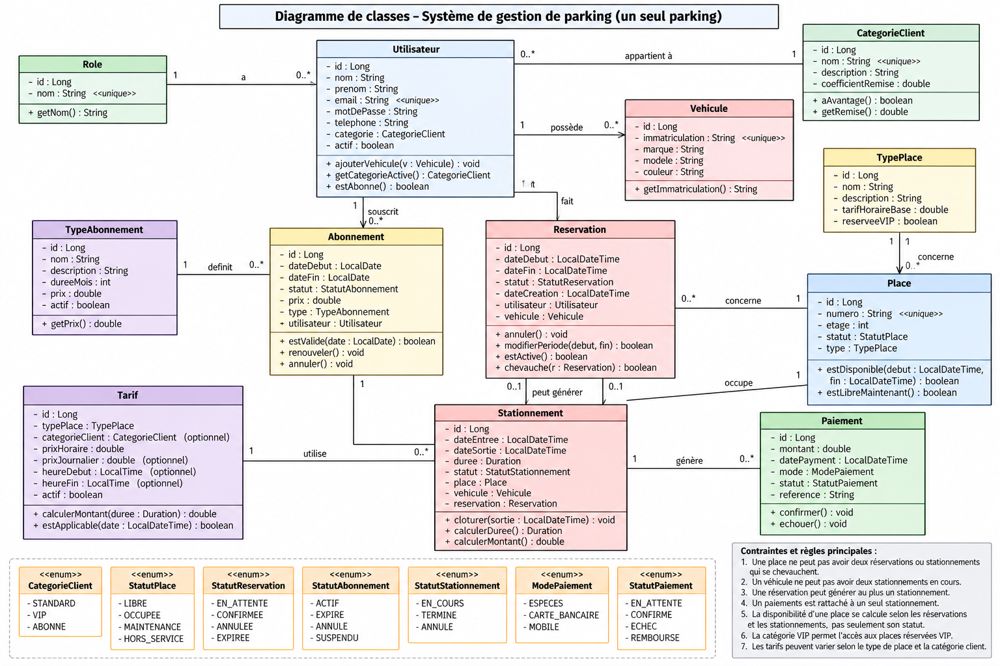

# Système de gestion de parking

Application web de gestion de parking développée avec **Java et Spring Boot**. Elle a pour objectif de faciliter l'administration d'un parking en centralisant la gestion des clients, des véhicules, des places, des réservations, des stationnements, des abonnements et des paiements.

Le système propose deux espaces distincts :
- **Espace administrateur** : administration et suivi des activités du parking.
- **Espace client** : accès aux fonctionnalités destinées aux clients.

> **Statut :** Projet en cours de développement. Certaines fonctionnalités sont déjà implémentées, tandis que d'autres nécessitent encore des améliorations et des développements complémentaires.

---

---

## Présentation du projet

La gestion manuelle d'un parking peut entraîner des difficultés dans le suivi des places disponibles, des réservations, des véhicules et des paiements.

Cette application vise à proposer une solution centralisée permettant de gérer les différentes opérations liées au fonctionnement d'un parking.

Elle repose sur une architecture organisée autour de plusieurs couches : contrôleurs, services, repositories, entités et composants de sécurité.

## Fonctionnalités

Les fonctionnalités suivantes correspondent aux différents modules présents dans le projet. Leur niveau d'achèvement peut varier.

### 1. Espace administrateur

- Gestion des utilisateurs.
- Gestion des rôles.
- Gestion des clients.
- Gestion des véhicules.
- Gestion des places de parking.
- Gestion des types de places.
- Gestion des réservations.
- Gestion des stationnements.
- Gestion des tarifs.
- Gestion des types d'abonnements.
- Gestion des abonnements.
- Gestion des paiements.
- Tableau de bord.
- Suivi financier.

### 2. Espace client

- Accès à un tableau de bord client.
- Consultation et gestion des véhicules.
- Gestion des réservations.
- Accès aux fonctionnalités liées aux abonnements et aux paiements.

### 3. Sécurité

- Authentification des utilisateurs.
- Gestion des rôles et des autorisations.
- Redirection des utilisateurs selon leur rôle après connexion.
- Protection des fonctionnalités selon les permissions.

---

## Technologies utilisées

### Backend
- **Java 21** : langage de programmation.
- **Spring Boot 4.1.1** : framework principal.
- **Spring MVC** : gestion des requêtes HTTP et des contrôleurs.
- **Spring Data JPA** : persistance et accès aux données.
- **Spring Security** : authentification et autorisation.
- **Spring Validation** : validation des données.
- **Thymeleaf** : moteur de templates pour les interfaces web.

### Base de données
- **PostgreSQL** : système de gestion de base de données relationnelle.
- **Flyway** : gestion des migrations de la base de données.

### Frontend
- HTML5
- CSS3
- JavaScript
- Thymeleaf

### Outils de développement
- Apache Maven
- Eclipse IDE
- Git
- GitHub

---

## Architecture du projet

Le projet suit une architecture en couches afin de séparer les responsabilités et de faciliter la maintenance du code.

```text
parking/
│
├── .mvn/
├── src/
│   ├── main/
│   │   ├── java/
│   │   │   └── com/exam/parking/
│   │   │       │
│   │   │       ├── config/
│   │   │       ├── controller/
│   │   │       │   └── web/
│   │   │       ├── entity/
│   │   │       ├── enumeration/
│   │   │       ├── repository/
│   │   │       ├── security/
│   │   │       ├── service/
│   │   │       │
│   │   │       ├── GenererMotDePasse.java
│   │   │       └── ParkingApplication.java
│   │   │
│   │   └── resources/
│   │       ├── db/
│   │       │   └── migration/
│   │       ├── static/
│   │       │   ├── css/
│   │       │   └── js/
│   │       ├── templates/
│   │       └── application.properties
│   │
│   └── test/
│       └── java/
│
├── .gitignore
├── mvnw
├── mvnw.cmd
├── pom.xml
└── README.md
```

### Diagramme UML

Le diagramme suivant présente la structure et les relations entre les principales entités du système.



### Responsabilités des couches

| Couche | Responsabilité |
|---|---|
| `config` | Configuration générale de l'application et de la sécurité. |
| `controller` | Réception et traitement des requêtes HTTP. |
| `entity` | Représentation des entités métier et des tables de la base de données. |
| `enumeration` | Définition des états, statuts et types utilisés dans l'application. |
| `repository` | Accès et opérations sur la base de données. |
| `security` | Authentification et gestion des autorisations. |
| `service` | Implémentation de la logique métier. |
| `templates` | Interfaces HTML générées avec Thymeleaf. |
| `static` | Ressources CSS et JavaScript. |

---

## Prérequis

Avant d'installer le projet, assurez-vous de disposer des outils suivants :

- Java Development Kit (JDK) 21.
- PostgreSQL.
- Git.
- Un IDE compatible Java (Eclipse recommandé).
- Une connexion Internet pour le téléchargement initial des dépendances Maven.

---

## Installation et configuration

### 1. Cloner le dépôt

```bash
git clone https://github.com/fenofaf7/gestion-parking-spring-boot.git
```

Accéder au répertoire du projet :

```bash
cd gestion-parking-spring-boot
```

### 2. Créer la base de données

Dans PostgreSQL, créer une base de données nommée :

```sql
CREATE DATABASE parking_db;
```

### 3. Configurer les variables d'environnement

Le fichier `application.properties` utilise des variables d'environnement pour protéger les informations de connexion à la base de données.

Configuration utilisée :

```properties
spring.application.name=parking
server.port=8088

spring.datasource.url=jdbc:postgresql://localhost:5432/parking_db
spring.datasource.username=${DB_USERNAME:postgres}
spring.datasource.password=${DB_PASSWORD}

spring.jpa.hibernate.ddl-auto=update
spring.jpa.show-sql=true
spring.jpa.properties.hibernate.format_sql=true
```

Définir les variables d'environnement dans PowerShell :

```powershell
$env:DB_USERNAME = "postgres"

$secure = Read-Host "Mot de passe PostgreSQL" -AsSecureString
$env:DB_PASSWORD = [System.Net.NetworkCredential]::new("", $secure).Password
```

Remplacer `postgres` par le nom de votre utilisateur PostgreSQL si nécessaire.

**Important :** ne publiez jamais vos mots de passe ou autres informations sensibles dans le dépôt GitHub.

### 4. Installer les dépendances et compiler le projet

Sous Windows :

```powershell
.\mvnw.cmd clean install
```

Sous Linux ou macOS :

```bash
./mvnw clean install
```

---

## Exécution de l'application

Sous Windows :

```powershell
.\mvnw.cmd spring-boot:run
```

Sous Linux ou macOS :

```bash
./mvnw spring-boot:run
```

Une fois l'application démarrée, accéder à l'adresse suivante :

**http://localhost:8088**

---

## Tests

Le projet dispose d'une configuration de tests avec Spring Boot Test.

Pour exécuter les tests :

Sous Windows :

```powershell
.\mvnw.cmd test
```

Pour effectuer une vérification complète :

```powershell
.\mvnw.cmd clean verify
```

---

## Base de données

Le projet utilise PostgreSQL pour stocker les informations relatives aux différentes opérations du parking.

Les entités JPA représentent les principales données métier :

- Utilisateur
- Rôle
- Client
- Catégorie client
- Véhicule
- Place
- Type de place
- Réservation
- Stationnement
- Tarif
- Abonnement
- Type d'abonnement
- Paiement

Les migrations de la base de données sont organisées dans le répertoire :

```text
src/main/resources/db/migration/
```

Flyway est utilisé pour gérer l'évolution du schéma de la base de données.

---

## Améliorations prévues

Le projet étant toujours en développement, plusieurs axes d'amélioration sont envisagés :

- Finalisation des fonctionnalités existantes.
- Amélioration de l'expérience utilisateur.
- Renforcement de la validation des données.
- Amélioration de la gestion des erreurs.
- Optimisation des requêtes et des performances.
- Enrichissement du tableau de bord et des statistiques.
- Ajout de tests unitaires et d'intégration supplémentaires.
- Documentation technique complémentaire.

---

## Auteur

**Fenokely**

Étudiant en Licence 3 Informatique à Esmia Innovation.

- GitHub : [@fenofaf7](https://github.com/fenofaf7)

---

*Projet académique réalisé dans le cadre de l'apprentissage et de la mise en pratique du développement d'applications web avec Java et Spring Boot.*